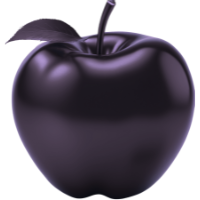

<div align="center">


### The only game where Isaac Newton runs around the world changing his gravity 🍎


</div>

---

## The game

**Newton** is a side-scrolling runner written in pure Java (Swing/AWT, no external libraries).
Newton runs to the right on his own and the screen moves with him. The player has a single control, **flipping gravity**, which sends him from the floor to the ceiling and back.

The goal is to reach the end of each level without falling off the screen, collect every apple and escape the enemy chasing you.

### Controls

| Key | Action |
|-----|--------|
| `Space` | Flip gravity (only while Newton is touching a surface) |
| `Esc` | Quit the game |
| Mouse | Navigate the menus |

### Mechanics

- **Gravity flipping**: Newton falls either down or up. He can only flip after landing, so every jump has to be planned.
- **Constant scrolling**: the camera moves forward on its own. If Newton falls behind, leaves the screen or drops into the void, the game is over.
- **Apples 🍎**: every level has 20 of them, each worth +1000 points.
- **Score**: grows with the distance travelled, plus the apple bonus.
- **Special blocks**:
  - 🔴 **Speed Up**: Newton speeds up
  - 🔵 **Speed Down**: Newton slows down
  - 🟡 **Reset**: back to normal speed
  - ⬛ **Deadly block**: touching it means game over
  - 🏁 **Finish**: completes the level
- **The shadow enemy**: a creature chases Newton and **repeats every gravity flip he makes with a one-second delay**. If it catches him, it's game over. If it falls behind, it respawns right behind him.

### Progress and high scores

For each level the game saves the best score and the highest number of apples collected (in `src/highscore.txt`). On the level select screen an icon shows each level's status:

| Icon | Meaning |
|:----:|---------|
|  | Level not completed |
|  | Level completed |
|  | Level **platinum**: all 20 apples collected |

---

## How to run it

You need **Java 8 or later** installed.

### Run the prebuilt JAR

The game reads its font and high scores from relative paths, so it must be launched **from the repository's root folder**:

```bash
git clone https://github.com/YoungStef17/NewtonGame.git
cd NewtonGame
java -jar dist/Newton.jar
```

### Build from source

```bash
javac -d out $(find src -name "*.java")
cp -r src/resource out/src/
java -cp out src.main.Game
```

---

## Project structure

```
src/
├── main/        # Entry point (Game), window, game states, HUD and high score management
├── screens/     # Screens: loading, menu, help, level select, gameplay, win, game over
├── entities/    # Game entities: Player (Newton), Enemy, Apple, Block
├── level/       # Level loading, camera, entity handler, keyboard input
├── utils/       # Sprite sheets, textures, animations, audio
└── resource/    # Images, sprites, levels, sounds and fonts
```

### Technical highlights

- **Game loop on a dedicated thread**: logic updates at 100 UPS and rendering at 60 FPS, handled independently with a time accumulator (delta time).
- **State machine** (`State` + `ScreenManager`) for switching between screens; every screen extends `AbstractScreen`.
- **Levels drawn as PNG images**: each pixel of the map becomes a 32×32 px block, and its color decides what gets spawned there (see the table below).
- **Multi-hitbox collisions**: every entity has separate rectangles for its top, bottom, left and right sides.
- **Enemy with an action queue**: the player's gravity flips are stored with a timestamp in a `Queue` and replayed by the enemy after 1000 ms.
- **Sprite sheet animations** and **audio** via `javax.sound.sampled` (background music and sound effects, which can be turned off from the Help menu).

### Making a level

To make a level, just draw a PNG in `src/resource/levels/` using these colors:

| Color (RGB) | Element |
|---|---|
| `255,255,255` white | Leaf block |
| `180,130,0` brown | Wooden block |
| `100,200,200` light cyan | Bridge |
| `255,0,0` red | Speed Up |
| `0,0,255` blue | Speed Down |
| `255,255,0` yellow | Normal speed |
| `128,128,128` gray | Deadly block |
| `255,0,255` magenta | Finish |
| `200,100,200` / `50,150,250` / `250,150,50` | Decorative signs (straight / up / down) |
| `192,192,192` light gray | Newton's starting point |
| `0,255,0` green | Apple |
| `0,255,255` cyan | Enemy |

---

## Project status

- ✅ Level 1 and Level 2 are playable
- 🚧 Level 3 is in development

## Authors

Made by **Stefano Michelini** and **Michele Coletti**.
